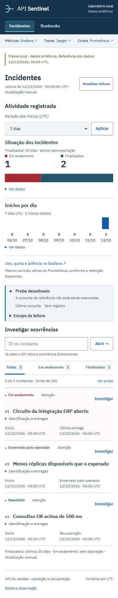
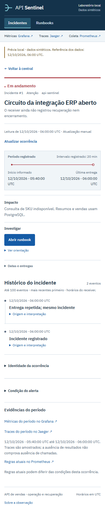

# Central e detalhe

As imagens foram capturadas no Edge, com larguras de 1440 e 390 px, usando a
central real sobre um banco sintético temporário. Para repetir a prévia sem Docker,
depois de instalar as dependências do projeto:

```sh
python tools/browser-checks/server.py --source . --run-dir .runtime/ui-capture --port 9196
```

Abra `http://127.0.0.1:9196/`. Use uma pasta nova em cada execução. O servidor
aceita somente GET/HEAD e não usa o banco da stack. Os filtros e a navegação
passam pelas rotas reais da central.

As imagens mostram a central local com dados sintéticos de referência de 12/10/2026, 06:00 UTC. O probe está desativado nesta prévia; os gráficos e a cronologia apresentam registros de exemplo, sem executar falha ou recuperação da API. Consulte o [guia da central](incident-console.md) para interpretar os dados.

As capturas mostram a interface atual, com filtro de período, busca e paginação.
Os estados e horários pertencem à prévia identificada, sem nova falha ou recuperação.

O `central.html` preservado em `artifacts/problem-review/20260921t064944662185z/` é uma resposta HTML histórica que depende de `/styles.css` e `/snapshot.js` da execução original. Aberto sozinho, conserva o conteúdo, mas não reproduz seu layout; para inspecionar a aparência histórica, use os PNGs da respectiva execução. Não combine esse HTML com CSS atual como prova original.

## Central


Os totais incluem os dois estados retidos. Os inícios por dia usam o agregado dos
incidentes retidos do filtro, no período UTC selecionado, independentemente da página.



## Detalhe


O período informado pelo alerta aparece separado dos horários de recebimento das entregas. Origem, interpretação e identificação ficam disponíveis por expansão.



`scripts/render_ui_preview.py` continua disponível para exportar casos estáticos.
Esse exportador inclui os assets locais, mas não implementa consultas, filtros de
período nem paginação dinâmica; suas contagens são marcadas como amostra parcial.

A [conta comercial](readme/commercial-fixture.svg) usa os valores da [fixture independente](../data/fixtures/manual-sales.json); o [mapa de arquitetura](readme/architecture.svg) mostra os componentes no mesmo host. Para uma sequência operacional já executada, veja [consulta, falha e recuperação de 22/09/2026](operational-story.md), com seus registros técnicos e imagens originais.
