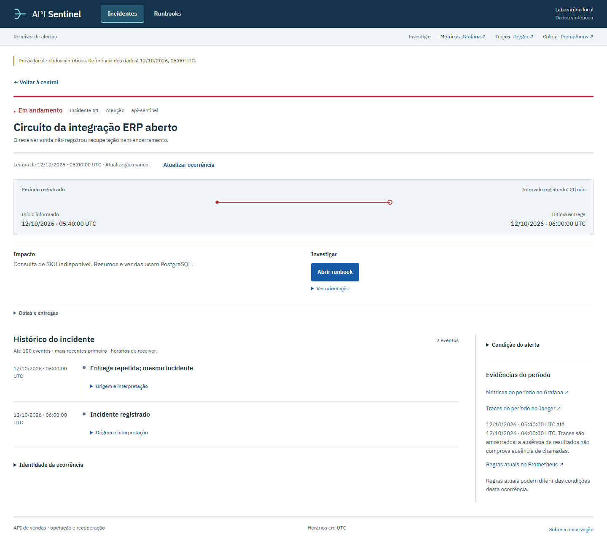

# Central e detalhe

Para gerar uma prévia sintética independente da stack, execute `python scripts/render_ui_preview.py --output .runtime/ui-preview` e sirva esse diretório como raiz HTTP: `python -m http.server 9185 --bind 127.0.0.1 --directory .runtime/ui-preview`. Abra `http://127.0.0.1:9185/`. O exportador inclui CSS, JavaScript, marca, favicon e fontes locais; caminhos absolutos como `/assets/…` exigem essa raiz. A prévia mostra casos fixos e não implementa consultas ou paginação dinâmica.

As imagens mostram a central local com dados sintéticos de referência de 12/10/2026, 06:00 UTC. O probe está desativado nesta prévia; os gráficos e a cronologia apresentam registros de exemplo, sem executar falha ou recuperação da API. Consulte o [guia da central](incident-console.md) para interpretar os dados.

As capturas preservam a interface de 12/10, anterior à paginação acrescentada depois: o texto de busca e os controles podem diferir da versão atual. Os estados e horários pertencem à prévia identificada.

O `central.html` preservado em `artifacts/problem-review/20260921t064944662185z/` é uma resposta HTML histórica que depende de `/styles.css` e `/snapshot.js` da execução original. Aberto sozinho, conserva o conteúdo, mas não reproduz seu layout; para inspecionar a aparência histórica, use os PNGs da respectiva execução. Não combine esse HTML com CSS atual como prova original.

## Central

Os totais incluem todos os estados retidos. Os inícios por dia usam somente a amostra carregada pelo filtro, nos sete dias UTC indicados.

## Detalhe

O período informado pelo alerta aparece separado dos horários de recebimento das entregas. Origem, interpretação e identificação ficam disponíveis por expansão.

A [conta comercial](readme/commercial-fixture.svg) usa os valores da [fixture independente](../data/fixtures/manual-sales.json); o [mapa de arquitetura](readme/architecture.svg) mostra os componentes no mesmo host. Para uma sequência operacional já executada, veja [consulta, falha e recuperação de 22/09/2026](operational-story.md), com seus registros técnicos e imagens originais.
